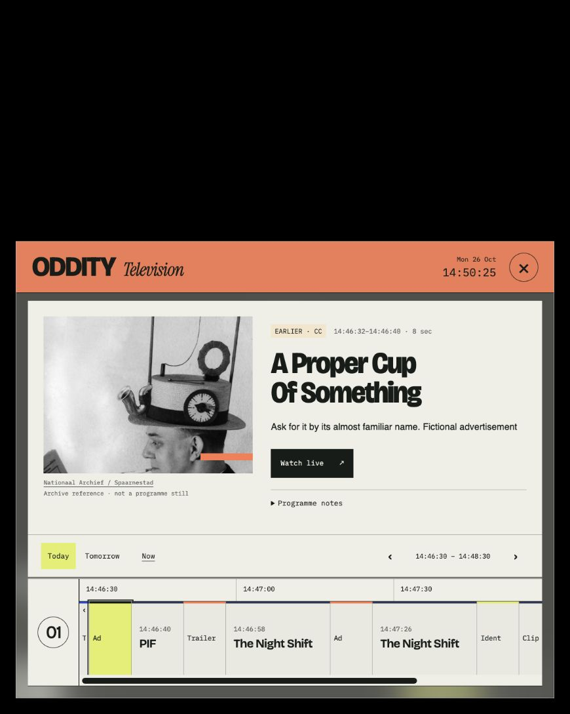
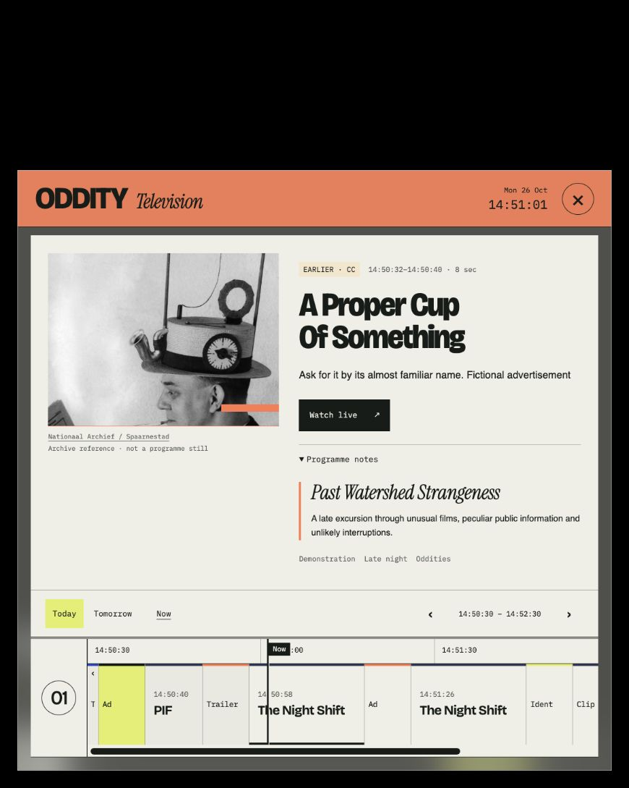

# Programming-block discovery: EPG flow review

26 October 2026. Scope: investigate a programming block from the existing Oddity guide, using the supplied “he’s turned the weans against you” treatment as the content example.

## Decision

The primary EPG object should be a scheduled programming block. Its individual films, adverts, television episodes and other pieces form an ordered running order. A collection can connect several independently schedulable blocks.

The simplified guide currently puts individual clips first and places the block introduction inside Programme notes. That preserves a clean screen but weakens the station’s editorial proposition. Promote block identity and its contents; keep technical programme metadata secondary.

This review changes no application code, scheduling or media. The attached treatment has not been imported or presented as an available broadcast. Film descriptions, selections and allocations below are taken from the supplied treatment; this review does not verify runtimes, availability or rights.

## Current flow and captured evidence

Captured in the Codex desktop built-in browser during this review, at 870×1089 CSS pixels. Screenshots were saved and reopened for inspection. The station was paused before the review and remains paused. The synthetic demo supplies the existing block context; the attached nine-hour treatment is a design example.

| Step | User action | Health for investigating a block | Finding |
| --- | --- | --- | --- |
| 1 | Inspect the selected programme in Guide | Works for a clip; poor for block discovery | The work title, image, synopsis and clock are clear. Its block is absent from the main hierarchy. The timeline has clip cells without a named block band. |
| 2 | Open Programme notes | Partial | A block title and short introduction appear. The title is plain text. It offers no route to a full running order, block times, editorial notes or related transmissions. |
| 3 | Explore the rest of that block | Blocked by the current interface | There is no block detail destination or complete contents list. Scrubbing/paging through clip cells asks the viewer to reconstruct the programme. |

### Step 1: programme entry

### Step 2: block context, with no onward route

Strengths worth keeping: stream-first playback, recognisable typography, compact controls, changing clip palettes, visible archive attribution and a single guide sheet. The main issue is the hierarchy and the next action, rather than the visual style.

## The content hierarchy in the attached treatment

| Level | Example | Meaning in the guide |
| --- | --- | --- |
| Collection | **he’s turned the weans against you** | A nine-hour editorial whole, composed of three related blocks. It may run as a takeover or across separate evenings. |
| Programming block | **01 / i’ve been very reasonable** | A three-hour, independently schedulable programme, with a premise, introduction and ordered contents. This is the primary EPG entry. |
| Work / authored entry | **The Squid and the Whale**, **The Big Snit**, or **small print** | A film, episode, short, advert package or other editorially selected part of the block. |
| Playback segment | A prepared file or a section before/after a break | Delivery detail. It should not accidentally create multiple independent editorial works. |

The other two blocks are **02 / nobody said that** and **03 / you had a nice time though**. Preserve the supplied lower-case titles. The collection’s three-part relationship should be visible without making all nine hours one giant film tile.

## Proposed viewer journey

1. **Find the block from the picture or the timetable.** When controls are visible, the now/next treatment includes a clear “In [block title]” link beside the current work. Opening Guide selects the current block. Upcoming and earlier blocks remain discoverable in the schedule.
2. **Select a block in the EPG.** A duration-proportional block band carries its title, scheduled start/end, part number when applicable and a labelled live state. Short adverts stop competing as primary guide tiles. The selected block fills the existing guide sheet, using its current image/type treatment.
3. **Read the premise and scan what is inside.** The block title and short introduction lead, followed by an ordered vertical running order. This list is visible by default. Each row gives its real broadcast time, title, format/year where useful, allocated/measured duration and position relative to live. A compact collection link reads “Part 1 of 3 · he’s turned the weans against you”.
4. **Investigate a work in place.** Select a row to expand its synopsis, factual details and an optional curator’s note. The block title, time window and position in its running order remain in context. Closing a work returns to the same list position. Browsing never retunes playback.
5. **Explore the other blocks when wanted.** The collection link opens a simple list of all three blocks with their own introductions and actual airings. Selecting one returns to its block detail. A back action restores the previous timetable position. Use the existing sheet instead of stacking modal panels.

The default reading hierarchy is block premise → running order → work detail. Long curator essays can use an optional “About this block” section after the introduction. Genre tags and technical metadata stay secondary.

## Example: inside block 01

The block overview leads with:

- Collection: **he’s turned the weans against you**
- Block: **01 / i’ve been very reasonable**
- Premise: **Authority and injured pride**
- Introduction: the supplied short paragraph beginning “We begin with the conviction that everyone else is the problem.”
- Duration: **3 hours**
- Contents: the complete ordered list, with the current work highlighted when this airing is live.

The treatment’s 00:00, 00:02 and 00:25 values are offsets inside the block. In a scheduled EPG, show actual local broadcast times. For illustration only, if block 01 started at 19:00, these rows would be:

| Broadcast time in this illustration | Work | Allocation from treatment |
| --- | --- | --- |
| 19:00 | nothing has happened — station opening | 2 min |
| 19:02 | The Girl Chewing Gum | 12 min |
| 19:14 | The Guardian: Points of View | 1 min |
| 19:15 | Selected educational films | 10 min |
| 19:25 | The Squid and the Whale | 81 min |
| 20:46 | The Big Snit | 10 min |
| 20:56 | small print | 4 min |
| 21:00 | The Royle Family: Bills, Bills, Bills | 28 min |
| 21:28 | Neighbours | 8 min |
| 21:36 | Gasman | 14 min |
| 21:50 | Scottish home-movie selection | 8 min |
| 21:58 | Limmy sketch and closing ident | 2 min |

These are proposed presentation examples, not scheduled or available media. A private editorial preview should identify provisional allocations and unscheduled blocks. A public airing should use the compiled, measured programme clock.

The point of this list is to make the curator’s sequence legible. The audience can discover the connection themselves. Avoid automatically expanding the essay explaining every juxtaposition or displaying a spoiler-like justification before each work.

## EPG and playback rules

- Keep one macro scale for **blocks in time** and one readable vertical scale for **works inside a block**. A two-hour film-cell window is a poor way to understand a three-hour curated block.
- Keep a named block band anchored across scrolling and repeated clips. Selecting a work keeps its parent block accessible.
- A block running order includes all authored entries, including adverts and home movies. Preserve titles such as “small print” rather than reducing everything of kind `advert` to an anonymous break.
- Show a film split by inserted adverts as one editorial work with clearly related continuation/break segments. Do not count its resumed section as another independent film.
- A live block offers **Join live**. Its label can say which work is currently on and how far through the block the broadcast is. It joins the real broadcast position.
- Future and earlier works offer information by default. Provide no Play-from-start or replay promise without an actual on-demand service. Earlier blocks remain readable as editorial records.
- Keep the viewer’s selected block/work and scroll position stable while the live clock moves. Now explicitly returns to the current broadcast.
- Show actual dates for separate-evening airings. Part 2 should not imply that it follows immediately tonight just because it belongs to a nine-hour collection.
- Keep colour changes between clip types. Give the selected parent block a persistent title/number/rule so its identity survives the palette changes. Parent identity must not depend on colour alone.

## Minimum content and API changes

The existing public event metadata already contains a programming profile ID, title, description, tags and block start/end. That is a useful foundation. It currently repeats this context on individual events; it does not expose a collection relationship or a complete block running-order object.

Add these distinct objects:

- **Collection:** stable ID, title, introduction, long-form editorial Markdown, and ordered block IDs.
- **Block definition:** stable ID, title, collection ID, sequence number, short premise, introduction/Markdown and ordered authored entries.
- **Block airing:** definition ID plus an occurrence-specific identifier, actual start/end, publication state and the compiled running order. A recurring profile ID by itself cannot identify tonight’s airing.
- **Work entry:** stable ID within its parent, asset/selection reference, editorial title/notes and ordered playback-segment references.

The server should resolve a block’s full contents independently of the current clip-grid time window and expose only public metadata. The viewer should not have to page through unrelated events to discover the block’s end. Parent/child relationships and editorial ordering belong in JSON; introductions and curator essays belong in Markdown. Avoid reconstructing the block solely from tags, repeated titles or browser-side grouping of whatever two-hour slice happens to be loaded.

This is a design recommendation, not a shipped schema or API. Preserve existing catalogue and schedule responsibilities when implementing it. Do not add a second independent timing source in an editorial Markdown file.

## Accessibility and verification limits

Observed: the current Programme notes disclosure is keyboard-addressable and its expanded title/introduction are visible; the block title itself is not an interactive navigation target. The screenshot hierarchy and DOM support the discovery finding.

For the proposed flow, use explicit “View block contents” labels, semantic ordered lists, full time labels and labelled live states. A meaningful link should replace plain block-title text. Restore focus to the invoking block/work when navigating back. Keep the selected details stable under automatic playout updates. Preserve reduced motion and adequate text contrast across changing palettes.

Only the existing desktop demo flow was audited in this run. The attached three-block treatment was read as editorial material; it is not present in the running catalogue. Full collection navigation, complete three-hour block rendering, mobile block exploration and screen-reader behaviour require a prototype and user testing. No accessibility-compliance claim is made.

## Recommended next implementation

Replace the guide’s clip-first selection with a block overview and its ordered running order inside the existing sheet. Keep the current visual language and simple controls. Use the supplied three-block treatment as a local editorial prototype, with clearly unscheduled draft content until real airings are assigned.
